<p align="center">
  
</p>

<p align="center">
  <a href="https://www.nuget.org/packages/Dryv.JsonSchema"></a>
  <a href="https://github.com/mhusseini/dryv/blob/main/LICENSE"></a>
</p>

<p align="center">
  <strong>Translates Dryv validation rules into JSON Schema (draft 2020-12) constraint fragments.</strong>
</p>

---

This package extends the core [Dryv](https://www.nuget.org/packages/Dryv) library with a `JsonSchemaTranslator` that converts C# validation expressions into JSON Schema properties — `minLength`, `pattern`, `minimum`, `required`, and many more.

## Installation

```shell
dotnet add package Dryv.JsonSchema
```

## Quick Start

```csharp
using Dryv;
using Dryv.JsonSchema;
using Dryv.Configuration;

// 1. Define your model with rules
public class Address
{
    public static readonly DryvRules Rules = DryvRules
        .For<Address>()
        .Rule(a => a.City,
            a => string.IsNullOrEmpty(a.City)
                ? "City is required"
                : DryvValidationResult.Success)
        .Rule(a => a.ZipCode,
            a => a.ZipCode.Length < 5
                ? "ZIP code must be at least 5 characters"
                : DryvValidationResult.Success);

    public string City { get; set; }
    public string ZipCode { get; set; }
}

// 2. Translate rules to JSON Schema
var translator = new JsonSchemaTranslator(new DryvOptions());
// ... use the translator via DryvTranslator to get a TranslationResult,
// then merge fragments into a full schema:
var schema = JsonSchemaTranslator.BuildSchema(translationResult, "Address");
```

The resulting schema:

```json
{
  "$schema": "https://json-schema.org/draft/2020-12/schema",
  "type": "object",
  "title": "Address",
  "properties": {
    "city": { "minLength": 1 },
    "zipCode": { "minLength": 5 }
  }
}
```

## How It Works

The `JsonSchemaTranslator` pipeline has three stages:

1. **`ConstraintExtractor`** — walks the validation lambda's expression tree and extracts JSON Schema keywords from the condition logic.
2. **`SchemaBuilder`** — wraps extracted constraints into per-property schema fragments and merges multiple fragments into a single document.
3. **`FormatHints`** — detects well-known regex patterns (email, URI, date, IPv4) and adds the corresponding `format` keyword.

Each Dryv rule produces a self-contained JSON Schema fragment (`{ "type": "object", "properties": { ... }, "required": [...] }`). The static `JsonSchemaTranslator.BuildSchema()` method merges all fragments for a model into one schema document.

## JsonSchemaTranslator — Detailed Capabilities

### Constraint Extraction Logic

The extractor analyses the Dryv ternary pattern:

```csharp
// Standard: failure condition ? "error" : DryvValidationResult.Success
m => failureCondition ? "error message" : DryvValidationResult.Success

// Inverted: success condition ? DryvValidationResult.Success : "error"
m => successCondition ? DryvValidationResult.Success : "error message"
```

Both orientations are supported. Nested ternaries and `BlockExpression` chains (compiler-generated for complex rules) are traversed recursively.

### Supported Constraints — Complete Reference

#### Null Checks → `required`

| C# Expression | Schema Output |
|---|---|
| `m.Prop == null ? "error" : Success` | `"required": ["prop"]` |
| `null == m.Prop ? "error" : Success` | `"required": ["prop"]` |
| `m.Prop != null ? Success : "error"` | `"required": ["prop"]` |

#### String Emptiness → `minLength`

| C# Expression | Schema Output |
|---|---|
| `string.IsNullOrEmpty(m.Prop) ? "error" : Success` | `"minLength": 1` |
| `string.IsNullOrWhiteSpace(m.Prop) ? "error" : Success` | `"minLength": 1` |

#### String Length → `minLength` / `maxLength`

The extractor recognises `.Length` access on `string` members, including through `.Trim()`, `.TrimStart()`, `.TrimEnd()`, `.ToLower()`, `.ToLowerInvariant()`, `.ToUpper()`, and `.ToUpperInvariant()` chains.

**Failure condition (condition ? "error" : Success):**

| C# Expression | Schema Output | Reasoning |
|---|---|---|
| `m.Prop.Length < N` | `"minLength": N` | Fails when too short → valid: length ≥ N |
| `m.Prop.Length <= N` | `"minLength": N + 1` | Fails when ≤ N → valid: length > N |
| `m.Prop.Length > N` | `"maxLength": N` | Fails when too long → valid: length ≤ N |
| `m.Prop.Length >= N` | `"maxLength": N - 1` | Fails when ≥ N → valid: length < N |
| `m.Prop.Trim().Length < N` | `"minLength": N` | Trim is unwrapped |

**Success condition (condition ? Success : "error"):**

| C# Expression | Schema Output |
|---|---|
| `m.Prop.Length >= N ? Success : "error"` | `"minLength": N` |
| `m.Prop.Length > N ? Success : "error"` | `"minLength": N + 1` |
| `m.Prop.Length <= N ? Success : "error"` | `"maxLength": N` |
| `m.Prop.Length < N ? Success : "error"` | `"maxLength": N - 1` |
| `m.Prop.Length == N ? Success : "error"` | `"minLength": N, "maxLength": N` |

**Inverted operand order** (constant on left) is also supported:

| C# Expression | Schema Output |
|---|---|
| `N > m.Prop.Length` (failure) | `"minLength": N` |
| `N <= m.Prop.Length` (success) | `"minLength": N` |

#### Numeric Comparisons → `minimum` / `maximum` / `exclusiveMinimum` / `exclusiveMaximum`

Works for `int`, `long`, `double`, `float`, `decimal`, `short`, `byte`, and their `Nullable<T>` counterparts.

**Failure condition:**

| C# Expression | Schema Output | Reasoning |
|---|---|---|
| `m.Num < N` | `"minimum": N` | Fails when < N → valid: ≥ N |
| `m.Num <= N` | `"exclusiveMinimum": N` | Fails when ≤ N → valid: > N |
| `m.Num > N` | `"maximum": N` | Fails when > N → valid: ≤ N |
| `m.Num >= N` | `"exclusiveMaximum": N` | Fails when ≥ N → valid: < N |

**Success condition:**

| C# Expression | Schema Output |
|---|---|
| `m.Num >= N ? Success : "error"` | `"minimum": N` |
| `m.Num > N ? Success : "error"` | `"exclusiveMinimum": N` |
| `m.Num <= N ? Success : "error"` | `"maximum": N` |
| `m.Num < N ? Success : "error"` | `"exclusiveMaximum": N` |
| `m.Num == N ? Success : "error"` | `"const": N` |

**Inverted operand order** (constant on left, e.g. `18 > m.Age`) is fully supported for all comparison directions.

#### Regex → `pattern` / `not: { pattern }`

| C# Expression | Schema Output |
|---|---|
| `!new Regex(@"^\d+$").IsMatch(m.Prop) ? "error" : Success` | `"pattern": "^\\d+$"` |
| `!regex.IsMatch(m.Prop) ? "error" : Success` | `"pattern": "..."` (extracted from captured object) |
| `Regex.IsMatch(m.Prop, pattern) ? Success : "error"` | `"pattern": "..."` |
| `Regex.IsMatch(m.Prop, pattern) ? "error" : Success` | `"not": { "pattern": "..." }` |

When a `pattern` is extracted in the success path, `FormatHints` checks whether it matches a well-known format:

| Regex Pattern | Inferred `format` |
|---|---|
| Contains `@...@` (email-like) | `"email"` |
| Contains `https?://` | `"uri"` |
| ISO 8601 date shape | `"date"` |
| IPv4 dot-quad shape | `"ipv4"` |

#### String Methods → `pattern` / `not: { pattern }`

| C# Expression | Schema Output |
|---|---|
| `!m.Prop.Contains("@") ? "error" : Success` | `"pattern": ".*@.*"` |
| `m.Prop.Contains("@") ? "error" : Success` | `"not": { "pattern": ".*@.*" }` |
| `!m.Prop.StartsWith("http") ? "error" : Success` | `"pattern": "^http"` |
| `m.Prop.StartsWith("http") ? "error" : Success` | `"not": { "pattern": "^http" }` |
| `!m.Prop.EndsWith(".com") ? "error" : Success` | `"pattern": "\\.com$"` |
| `m.Prop.EndsWith(".com") ? "error" : Success` | `"not": { "pattern": "\\.com$" }` |

String arguments are regex-escaped via `Regex.Escape()`.

#### String Equality → `const`

| C# Expression | Schema Output |
|---|---|
| `m.Prop != "value" ? "error" : Success` | `"const": "value"` |
| `m.Prop == "value" ? Success : "error"` | `"const": "value"` |

Works with the constant on either side of the comparison.

#### Numeric Equality → `const`

| C# Expression | Schema Output |
|---|---|
| `m.Num == 42 ? Success : "error"` | `"const": 42` |

#### Boolean Properties → `const`

| C# Expression | Schema Output |
|---|---|
| `!m.BoolProp ? "error" : Success` | `"const": true` |
| `m.BoolProp ? Success : "error"` | `"const": true` |
| `m.BoolProp ? "error" : Success` | `"const": false` |

#### Collection Count → `minItems` / `maxItems`

Works on `.Count` and `.Length` properties of collection types (`List<T>`, arrays, etc.).

**Failure condition:**

| C# Expression | Schema Output |
|---|---|
| `m.Items.Count < N` | `"minItems": N` |
| `m.Items.Count <= N` | `"minItems": N + 1` |
| `m.Items.Count > N` | `"maxItems": N` |
| `m.Items.Count >= N` | `"maxItems": N - 1` |

**Success condition:**

| C# Expression | Schema Output |
|---|---|
| `m.Items.Count >= N ? Success : "error"` | `"minItems": N` |
| `m.Items.Count > N ? Success : "error"` | `"minItems": N + 1` |
| `m.Items.Count <= N ? Success : "error"` | `"maxItems": N` |
| `m.Items.Count < N ? Success : "error"` | `"maxItems": N - 1` |

#### Logical Combinators

| C# Pattern | Behaviour |
|---|---|
| `cond1 && cond2` (in failure position) | Both conditions are extracted as failure constraints |
| `cond1 \|\| cond2` (in failure position) | Both conditions are extracted (best-effort merge) |
| `cond1 && cond2` (in success position) | Both conditions are extracted as success constraints |
| `cond1 \|\| cond2` (in success position) | Both conditions are extracted (best-effort merge) |

#### Negation

`!(expr)` flips the extraction path: a negated failure condition delegates to the success extractor and vice versa, ensuring constraints are correctly inverted.

### Schema Output Format

Each per-rule fragment is a JSON object:

```json
{
  "type": "object",
  "properties": {
    "propertyName": {
      "minLength": 3,
      "pattern": "^[a-z]+$"
    }
  },
  "required": ["propertyName"]
}
```

The merged schema (via `BuildSchema`) follows JSON Schema draft 2020-12:

```json
{
  "$schema": "https://json-schema.org/draft/2020-12/schema",
  "type": "object",
  "title": "OptionalTitle",
  "properties": {
    "prop1": { "minLength": 1 },
    "prop2": { "minimum": 0, "maximum": 100 }
  },
  "required": ["prop1"]
}
```

When multiple rules target the same property, their constraints are merged (later constraints overwrite earlier ones with the same key).

### Property Name Formatting

Property names are emitted in camelCase by default (`FirstName` → `firstName`), matching the default `System.Text.Json` serialization convention.

### Limitations

- **No `oneOf` / `anyOf` / `allOf` composition** — logical OR between constraints on the same property is merged best-effort rather than producing JSON Schema combinators.
- **Dynamic values** — only compile-time constant comparisons are extracted. Expressions referencing injected services or runtime variables are silently skipped.
- **`string.Format` / interpolation** — not applicable to schema constraint extraction.
- **Enum constraints** — enum comparisons are not currently mapped to `enum` keyword arrays.

## License

[MIT](../LICENSE)
